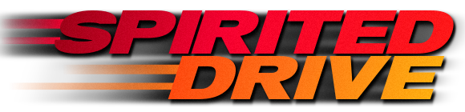

  

  <em>The Need for Speed</em> Special Edition (1996), rebuilt to run natively on modern machines. 
  Play it as it was, on a modern screen, or restomodded.

  
  &nbsp;
  

---

Spirited Drive is a from-scratch reimplementation of the 1996 PC classic. It is not an emulator and it does not wrap the old executable: every system was rebuilt in portable C, so it runs as a native app on today's hardware. You bring your own copy of the game, and the app reads its tracks, cars and sounds.

## Three ways to play

- **Stock '96** — *Factory spec, recalls done.* The 1996 game in 4:3: its look, its handling. Nothing touched but the bugs.
- **Restored '96** — *Original paint, new bearings.* The same look, in widescreen, up to 144 Hz.
- **Restomod '26** — *Original block, modern running gear.* As you remember it, not as it was. The graphics stay true to the era (its techniques, its 256-colour palette), and today's cores fill the game with detail no 1996 PC could run: night lighting, weather, a free camera, gamepads, and everything below. Yours to tune.

You can switch modes at any time from Game Mode, and each mode keeps its own settings.

## What Restomod adds

- **Wide and sharp**: 16:9 and 21:9 with the original pixels, just wider. 60 / 120 / 144 Hz with smooth motion between the game's steps. 2x and 3x render scale, an adjustable field of view, and view distance up to Ultra.
- **Night that glows**: halos on street lamps and tunnel lights, pools of light on the road, headlight beams that light up the road and the walls, and lit dashboards.
- **Weather**: rain with spray from every car and working wipers in the cockpit view, real snow on Alpine, and gravel, dust and mud on the rally stages.
- **A free camera**: look all around the car. A wrong-way warning keeps you headed the right way.
- **Pads, properly**: bind every action to keys, buttons, triggers or axes, with dead zone, sensitivity and force feedback.
- **More to race**: mirror and rally versions of every track, the cut moon track (Lunar Springs), Lost Vegas, and separate record tables for mirror, rally and cheats.
- **Race friends**: network races over your LAN or the internet.
- **Make it yours** *(work in progress)*: mods load from a folder, without touching your game files. The light, the lamps and the masks of every track are plain files you can edit.

## Customize Game: the garage door is open

One screen, in every mode, for everything the original hid behind typed codes and for what we added. Open it from Game Mode or from Options.

- **The original cheats, as switches**: Explode, Nitro, Turbo and the Warrior. The typed codes still work, and races run with a cheat keep their own record table.
- **The hidden tracks**: Lost Vegas, and **Lunar Springs**, the moon track cut from the 1996 game, recovered and drivable, with moon gravity if you want it.
- **Every track again**: mirrored, as a rally stage, and the circuits in reverse (pick Reverse in Track Select).
- **The Warrior as your rival**, not only as your car.
- **Car colours**: more paints for every car.
- **Difficulty**: Easy, Original or Hard, for rivals, police and traffic together.
- **More cameras**: a 360 camera that looks all around the car, the replay cameras while you race, a mirror in the bumper view, and the police radar in the exterior views.
- **Your dash**: speed in mph or km/h, and the map, the gear lever or nothing in the dash box.

## Install (macOS)

1. Download the `.dmg` from the [latest release](https://github.com/BytesNRust/spirited-drive/releases/latest). It is one app for both Apple Silicon and Intel Macs, macOS 11 or later.
2. Open the DMG and drag **Spirited Drive** to Applications.
3. **The first time only**, macOS will say it cannot check the app, because it is not notarized by Apple. Right-click the app, choose **Open**, then **Open** again. On recent macOS: try to open it once, then go to **System Settings → Privacy & Security** and click **Open Anyway**.
4. On first start the app asks for your game: choose the CD, a folder with its files, or an ISO image. It copies what it needs, and you can put the CD away.

Updates: the game tells you when a new version is out.

## You need the original game

Spirited Drive contains no EA content. You need your own copy of ***The Need for Speed* Special Edition for PC (1996)**. Please don't ask for, or share, copies of the game. No drive on your Mac? An external USB CD drive works, or an ISO image you made from your own disc.

## Questions

- **Can I play it like the original?** Yes: pick **Stock '96**.
- **Does it send anything?** An update check at start-up and three anonymous counters, nothing else. Turn them off in **Customize Game**, page 3, **Updates and anonymous stats**.

## Help and feedback

- Something wrong? [Open an issue](https://github.com/BytesNRust/spirited-drive/issues) and attach `spirited-drive.log` (**Customize Game**, page 3, **Open the log folder**). Please don't attach files from the original game.
- [Playing](docs/playing.md) · [Settings](docs/settings.md) · [Network races](docs/online.md) · [Modding](docs/modding.md) · [Building from source](docs/building.md)

## Credits

Made by **Bytes & Rust**. Code under the [GPL v3](LICENSE). The game data, names and trademarks belong to their owners. This project is not affiliated with or endorsed by Electronic Arts.
