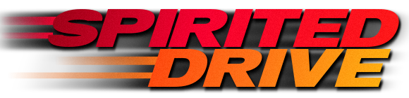

  

  <em>The Need for Speed</em> Special Edition (1996), rebuilt to run natively on modern machines. 
  Play it as it was, on a modern screen, or restomodded.

  <a href="https://bytesnrust.com/spirited-drive/"><strong>Website</strong></a> ·
  <a href="https://github.com/BytesNRust/spirited-drive/releases/latest"><strong>Download</strong></a> ·
  <a href="https://github.com/BytesNRust/spirited-drive/discussions"><strong>Discussions</strong></a>

  
  &nbsp;
  

---

Spirited Drive is a from-scratch reimplementation of the 1996 PC classic. It is not an emulator and it does not wrap the old executable: every system was rebuilt in portable C, so it runs as a native app on today's hardware. You bring your own copy of the game, and the app reads its tracks, cars and sounds.

## Three ways to play

<!-- DRAFT: announcement text from notes/textos-anuncio-2026-11-25.md, not approved as final -->
- **Stock '96** — *Factory spec, recalls done.* The 1996 game as it shipped: 4:3 picture, original menus. Nothing is changed but its bugs, and what it takes to run on a computer from today.
- **Restored '96** — *Original paint, new bearings.* The same game on a modern screen: widescreen and smooth motion up to 144 fps. Nothing else is changed.
- **Restomod '26** — *Original block, modern running gear.* Everything in Restored, plus weather, four times of day, night lighting, cars that shine and change colour, a dashboard that lights up, mirror, reverse and rally versions of the tracks, and the lost moon track.

All three play with keyboard, gamepad or wheel, and all three race over the network (macOS only for now, very beta). You can switch modes at any time from Game Mode, and each mode keeps its own settings.

<!-- DRAFT: announcement text from notes/textos-anuncio-2026-11-25.md, not approved as final -->
## What Restomod adds

The game it could have been with a few more years of development: dozens of additions, large and small, all drawn the way a game of its time would have drawn them.

**All of it in 8-bit.** Every frame is 256-colour indexed art, drawn the way the 1996 game drew, with no true-colour stage anywhere. Light adds no paint: dusk, tunnels and street lamps recolour the palette, they never leave it. Glows and shine are dithered, the way 1996 faked a gradient. The patina stays.

- **Turn around: the world is all there.** In 1996 the camera never followed the car all the way round. Turn too far and the view stopped turning, because the road behind you was never drawn. In Restomod the camera follows the car through the full 360 degrees and the whole track is there, in front and behind. Spin, drive the wrong way, or hold **Look back** to see who is on your tail. In 1996 the only way to see behind you was the mirror of the cockpit view; we have kept it, and brought it to the bumper view too. It is real 3D now.
- **A mirror where you need it**: the original had a rear-view mirror in the cockpit view only. Restomod puts one in the bumper view as well.
- **Weather on every track**: rain, storms with lightning and thunder, fog, and snow in the mountains. Every car throws spray, the wet road mirrors the lamps, and in the rain everyone drives with their lights on.
- **Four times of day**: dawn, day, dusk and night, each with its own light and the sun's shadows across the road.
- **Night that glows**: headlight beams on the road and the walls, halos on street lamps, tunnel lights, brake lights and police lights, and reflectors that catch your beams.
- **Cars with a shine**: bodywork that reflects, and more colours for every car.
- **A dashboard that lives**: gauges lit at night in each car's own colour, wipers that keep pace with the rain, drops and snowflakes hitting the glass.
- **Every track again**: mirror, rally and, on circuits, reverse, as switches on the track itself. Gravel, dust and mud on the rally stages.
- **Lunar Springs**: the moon track the PC game never got to show (the story is below).
- **Sharper picture**: 2x and 3x render scale, correct perspective, view distance up to Ultra.
- **More cameras**: the police radar in every view, the replay cameras while you race.
- **Records your way**: a table per track, layout and lap count.

**Always in the workshop.** Restomod's car shine and colours and its track lighting are being tuned track by track and car by car. Expect some reflections in the wrong place, paint that does not take its colour, and tunnels or shadows that look off. The engine is solid; this is art and tuning, and it gets better with every update. Stock '96 and Restored '96 are not affected.

**Network races** work in all three modes, over your LAN or the internet, **on macOS only for now**. They are **very beta**: they have had little testing, so expect problems and tell us what you find.

**The engine is open, and an editor is coming.** We did not only rebuild the game: we opened it up. **Spirited Drive Studio** *(work in progress, not available to download yet)* is the editor that goes with it. It will let you tweak what is already in the game, and build entirely new cars and tracks with your own art.

## Customize Game: the garage door is open

<!-- DRAFT: announcement text from notes/textos-anuncio-2026-11-25.md, not approved as final -->
One screen for everything the original hid behind typed codes and for what we added. It is in every mode. Stock and Restored keep the original's spirit: there it offers some of the original cheats as switches, the speed units, and the unlock level, so you can open the extras the 1996 game kept for tournament winners without winning them again. Restomod adds everything new, each thing with its own switch. Open it from Game Mode or Options.

- **The original cheats, as switches**: Explode, Nitro, Turbo and the Warrior. The typed codes still work, and races run with a cheat keep their own record table.
- **The hidden tracks**: Lost Vegas, and (Restomod only) **Lunar Springs**, a track on the moon. It was among the PC game's files, but the team ran out of time and the PC version shipped without it; PlayStation players did get to drive it. We found it where they left it, in the PC files, finished the job, and now you can drive it too, with the moon's gravity if you like.
- **Every track again**: mirrored and as a rally stage in every mode; the circuits in reverse (pick Reverse in Track Select) in Restomod.
- **The Warrior as your rival**, not only as your car.
- **Car colours** (Restomod): more paints for every car.
- **Difficulty** (Restomod): Easy, Original or Hard, for rivals, police and traffic together.
- **Seeing behind** (Restomod): the full 360 camera with a Look back button, and a mirror in the bumper view as in the cockpit view.
- **More cameras** (Restomod): the replay cameras while you race, and the police radar in the exterior views.
- **Your dash**: speed in mph or km/h, and the map, the gear lever or nothing in the dash box.

## Install (macOS)

1. Download the `.dmg` from the [latest release](https://github.com/BytesNRust/spirited-drive/releases/latest). It is one app for both Apple Silicon and Intel Macs, macOS 11 or later.
2. Open the DMG and drag **Spirited Drive** to Applications.
3. **The first time only**, macOS will say it cannot check the app, because it is not notarized by Apple. Right-click the app, choose **Open**, then **Open** again. On recent macOS: try to open it once, then go to **System Settings → Privacy & Security** and click **Open Anyway**.
4. On first start the app asks for your game: choose the CD, a folder with its files, or an ISO image. It copies what it needs, and you can put the CD away.

**Windows 10 or 11, 64-bit** <!-- DRAFT [WIN]: file name and steps wait for the Windows package -->: the app is not signed yet either, so the first time Windows warns that it is from an unknown publisher: choose **More info**, then **Run anyway**. The Windows version has no network races yet.

Updates: the game tells you when a new version is out.

## You need the original game

Spirited Drive contains no EA content. You need your own copy of ***The Need for Speed* Special Edition for PC (1996)**. Please don't ask for, or share, copies of the game. No drive on your Mac? An external USB CD drive works, or an ISO image you made from your own disc.

## Questions

- **Can I play it like the original?** Yes: pick **Stock '96**.
- **Does it send anything?** An update check at start-up and three anonymous counters. Each carries the game's version and your system (macOS, Windows or Linux); the API works out the country from the connection and keeps only daily totals: no IP, no ID. Turn them off in **Customize Game**, page 3, **Updates and anonymous stats**.

## Help and feedback

- Something wrong? [Open an issue](https://github.com/BytesNRust/spirited-drive/issues) and attach `spirited-drive.log` (**Customize Game**, page 3, **Open the log folder**). Please don't attach files from the original game.
- [Playing](docs/playing.md) · [Settings](docs/settings.md) · [Network races](docs/online.md) · [Modding](docs/modding.md) · [Building from source](docs/building.md)

## Credits

Made by **Bytes & Rust**. Code under the [GPL v3](LICENSE). The game data, names and trademarks belong to their owners. This project is not affiliated with or endorsed by Electronic Arts.
